# Market Watch UI — Before / After

This document records what the application looked like and how it worked before the
API migration, what it looks like and how it works now, and why each change was made.
It is organised by the use cases that were requested, in the order they were delivered.

All "after" screenshots are in [`screenshots/`](screenshots) (headless Chromium, 1440 px,
`America/New_York`); the "before" screenshots in [`before/`](before) are the ones shipped with the
original code base, captured at the same width.

---

## 1. Executive summary

| # | Use case | Status |
| --- | --- | --- |
| 1 | Look up a symbol via the new `GET /stock/{symbol}` API (no historic data in the response) | ✅ |
| 2 | Show the new response fields as tiles | ✅ (Symbol, Company, Full-day Price, Sector, Exchange, Market, Currency) |
| 3 | Offline mode driven by the captured `json/` responses | ✅ 39 fixtures under `public/data/` |
| 4 | Remove all CSV code; keep the chart and table components | ✅ |
| 5 | "Past Performance" section with a Day / Week / Month / Six Months / Year / 5 Years selector | ✅ |
| 6 | **Performance** button calling `GET /stock/{symbol}/historic?period=` and `GET /stock/{symbol}/highlow?period=` | ✅ |
| 7 | Populate high/low tiles, the chart and the table from those calls, matching the original presentation | ✅ |
| 8 | Visual polish: one connected panel, dark toolbars, no title, no Language tile, header styled like the toolbar | ✅ |

**Before:** one screen, one data shape. A lookup fetched 24 hourly prices (from a CSV or a
placeholder `/prices` API) and derived everything — price, high/low, change, chart, table — from
that single series.

**After:** the same screen, split into two interactions backed by three endpoints. A lookup shows the
stock's *reference data*; a second, explicit action loads its *past performance* for a chosen period.
The offline mode mirrors the live API file-for-file, so both paths run through identical parsing code.

| Metric | Before | After |
| --- | --- | --- |
| Production source (lines, `src/**/*.ts[x]` excl. tests) | 1 794 | 2 543 |
| Test source (lines) | 1 627 | 2 663 |
| Test files / tests | 28 / 172 | 36 / 275 |
| API endpoints consumed | 1 (`/prices`, never live) | 3 (`/stock`, `/historic`, `/highlow`) |
| Offline fixtures | 1 CSV (5 symbols × 24 rows, synthetic) | 39 JSON files (real captured responses) |
| `npm run build`, `tsc -b`, `eslint` | clean | clean |

---

## 2. The screen, before and after

<table>
<tr><th width="50%">Before — AAPL from the CSV</th><th width="50%">After — AAPL, "Week" performance loaded</th></tr>
<tr>
<td>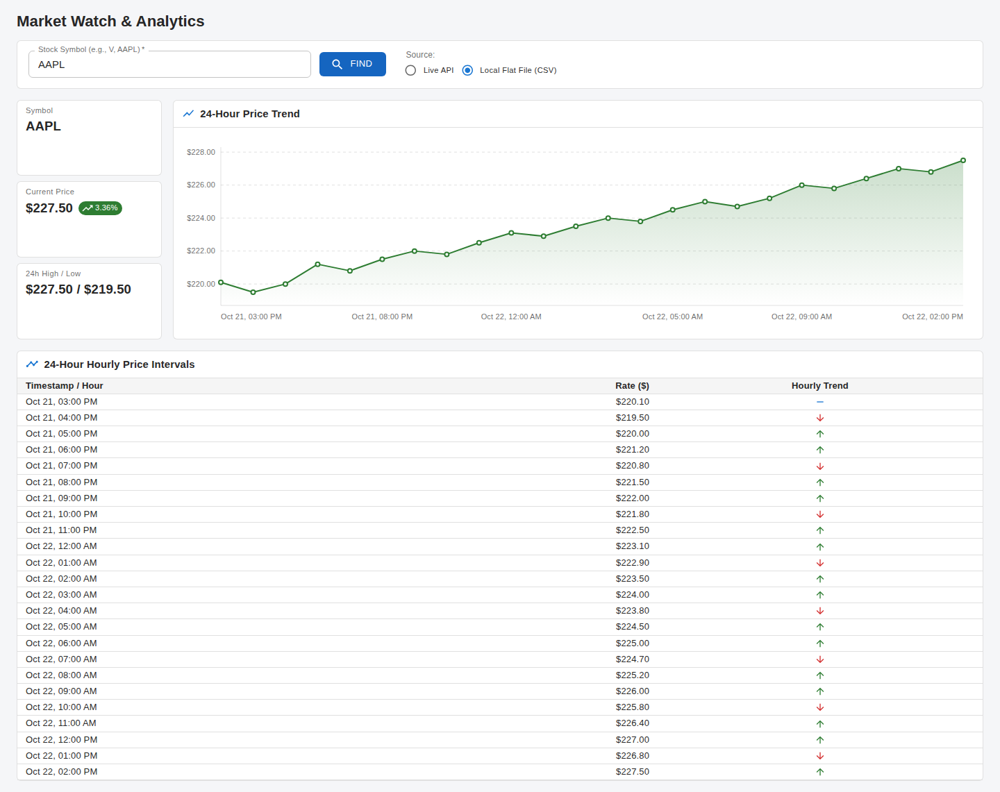</td>
<td>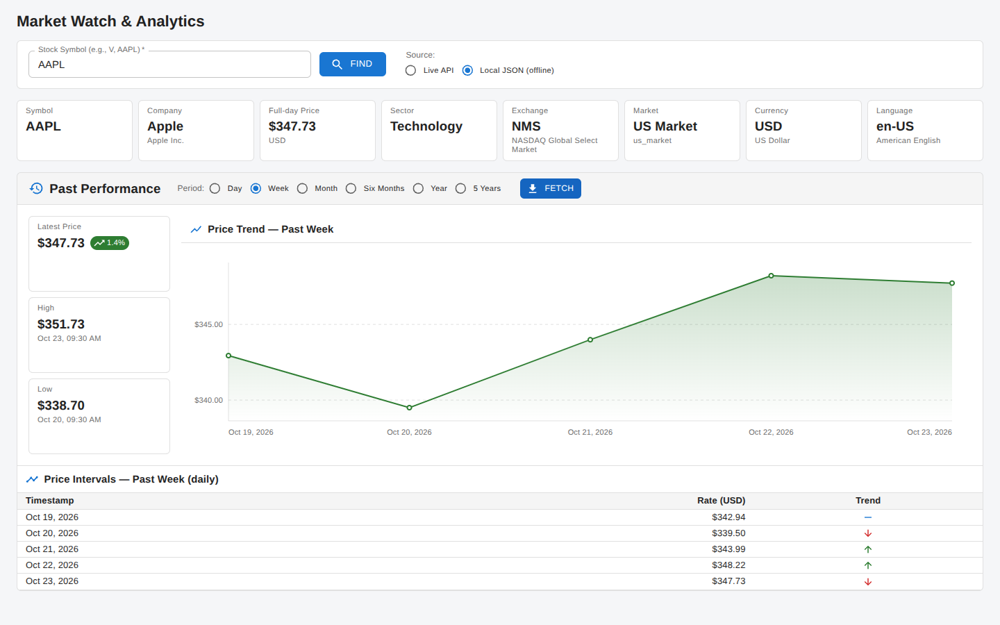</td>
</tr>
</table>

What is the same: the lookup row, the "tiles beside a chart, table beneath" composition, the chart
and table components themselves, the per-row trend arrows, the loading and error conventions.

What is different:

1. A row of **detail tiles** from `GET /stock/{symbol}` sits directly under the lookup row.
2. The chart/table block is now a **Past Performance panel** with its own dark toolbar (period radios +
   **Performance** button) and is empty until that button is clicked.
3. The **summary tiles** beside the chart changed meaning: *Latest Price* (with change over the chosen
   period) and *High* / *Low* with the exact time each occurred, sourced from `/highlow` rather than
   inferred from the sampled series.
4. Chart and table titles name the loaded window and its sampling interval
   (e.g. *Price Intervals — Past Week (daily)*) instead of a fixed "24-Hour …".
5. Both the page header and the panel toolbar are dark with white bold text.

---

## 3. Use cases in detail

### 3.1 Look up a symbol via `GET /stock/{symbol}`

**Before.** The "Live API" option called a placeholder `GET /prices/{symbol}?interval=1h&limit=24`
that never existed; every successful lookup came from the CSV. The response shape was assumed:

```
{ "symbol": "AAPL", "prices": [ { "timestamp": "…", "price": 220.10 }, … ] }
```

**After.** `LiveApiStockProvider.getDetails` calls `GET {base}/stock/{SYMBOL}` and parses the real shape
captured in `json/detail-*.json`:

```
{ "ticker": "AAPL", "symbol": "AAPL", "displayName": "Apple", "longName": "Apple Inc.",
  "sector": "Technology", "exchange": "NMS", "market": "us_market",
  "currency": "USD", "language": "en-US", "fulldayPrice": 347.725 }
```

Only `symbol` (falling back to `ticker`) is mandatory; every other field is optional so a thinner
response degrades to fewer tiles rather than an error. 404 → "Symbol not found"; network, timeout,
HTTP and malformed-body failures keep their typed `LiveApiError`s and user-readable banners.

<table>
<tr><th width="50%">Before — unreachable placeholder (<code>/prices/AAPL?…</code>)</th><th width="50%">After — same state, new endpoint (<code>/stock/AAPL</code>)</th></tr>
<tr>
<td>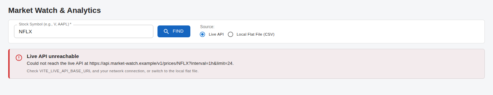</td>
<td>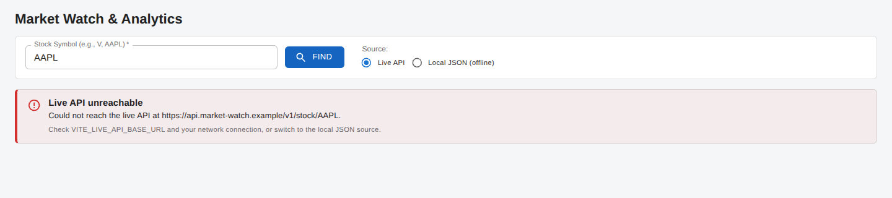</td>
</tr>
</table>

### 3.2 New tiles for the new data

**Before.** Three tiles, all derived from the price series: *Symbol*, *Current Price* (+24 h change
chip), *24h High / Low*.

**After.** A responsive `auto-fit` grid of seven tiles, each rendered only when its field is present:

| Tile | Field | Presentation |
| --- | --- | --- |
| Symbol | `symbol` / `ticker` | upper-cased |
| Company | `displayName` + `longName` | short name, legal name beneath |
| Full-day Price | `fulldayPrice` + `currency` | `Intl` currency formatting (`$347.73`), code beneath |
| Sector | `sector` | as-is |
| Exchange | `exchange` | code, plus full name for known codes (`NMS` → NASDAQ Global Select Market) |
| Market | `market` | humanised (`us_market` → US Market), raw value beneath |
| Currency | `currency` | code, plus `Intl.DisplayNames` name (US Dollar) |

`language` is parsed onto the model but deliberately not tiled (removed on request in the final
polish round).

<table>
<tr><th width="50%">Before — overview row</th><th width="50%">After — detail tiles + empty performance toolbar</th></tr>
<tr>
<td>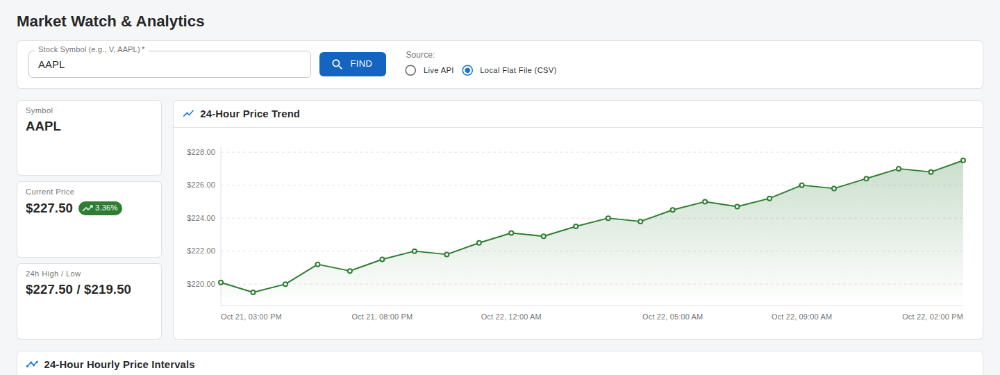</td>
<td>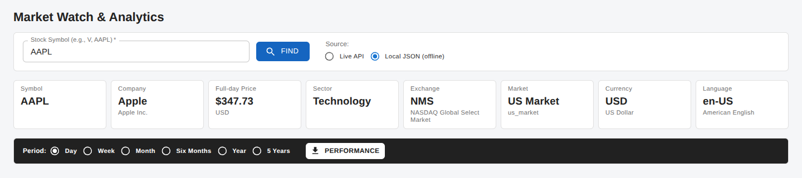</td>
</tr>
</table>

### 3.3 Offline mode from the captured responses

**Before.** "Local Flat File (CSV)" read `public/local-data.csv` — synthetic prices with no company
data, and a different data shape from the API.

**After.** "Local JSON (offline)" reads `public/data/`, one file per endpoint call, named after the
endpoint it stands in for:

```
detail-{SYMBOL}.json              ⇐ GET /stock/{SYMBOL}
historic-{SYMBOL}-{PERIOD}.json   ⇐ GET /stock/{SYMBOL}/historic?period={PERIOD}
highlow-{SYMBOL}-{PERIOD}.json    ⇐ GET /stock/{SYMBOL}/highlow?period={PERIOD}
```

All 39 files are copies of the captures in `json/`, identified by *content* rather than file name —
which is how the two mis-named captures (`2026-10-25T003427.200.json` = `historic-AAPL-DAY`,
`hihglow-META-FIVE_YEAR.json` = `highlow-META-FIVE_YEAR`) landed in the right place. Because the
offline provider runs the *same parsers* as the live provider, offline mode exercises the real
contract, not a simplified one. A guard test (`localFixtures.test.ts`) fails if any symbol × period
file is missing or stops parsing.

A symbol without fixtures shows the familiar not-found banner with clickable suggestions:

<table>
<tr><th width="50%">Before — unknown symbol in the CSV</th><th width="50%">After — unknown symbol in the offline data</th></tr>
<tr>
<td>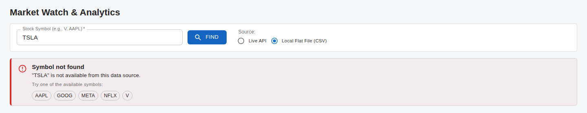</td>
<td>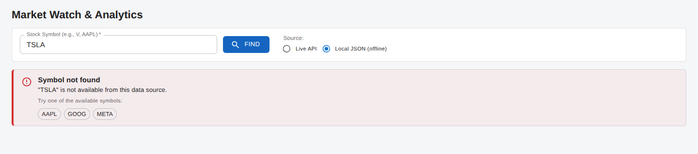</td>
</tr>
</table>

### 3.4 CSV removal

Deleted: `src/data/csv/` (tokenizer, row parser), `CsvPriceProvider`, `public/local-data.csv`, their
tests and the CSV-specific README sections. `normalizeSymbol` — the one helper in that folder unrelated
to CSV — moved to `utils/symbol.ts`. `PriceChart`, `HourlyPriceTable` and `StockSummaryCards` were kept
as asked and are now fed from the historic API instead.

### 3.5 Past Performance section and period selector

A `<section>` (accessible name "Past Performance") beneath the tiles. Its toolbar holds the
`Period:` radio group — Day / Week / Month / Six Months / Year / 5 Years, default Day — whose values
are the API's own identifiers (`DAY … FIVE_YEAR`), so the selection maps to the request verbatim.
The choice persists across symbol lookups.

### 3.6 The **Performance** button: two calls per click

Clicking **Performance** runs, in parallel, for the loaded symbol and the selected period:

```
GET {base}/stock/{SYMBOL}/historic?period={PERIOD}
GET {base}/stock/{SYMBOL}/highlow?period={PERIOD}
```

It uses the *source the symbol was loaded with*, so flipping the Live/Local radio after a lookup
cannot silently mix sources. The panel has its own loading indicator and error banner; a failure
leaves the detail tiles above untouched.

<table>
<tr><th width="50%">Fetch in progress (toolbar disabled, panel-local status)</th><th width="50%">Fetch failed (error contained in the panel)</th></tr>
<tr>
<td>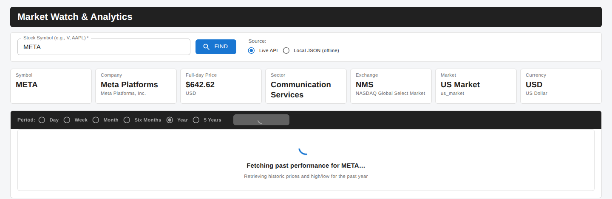</td>
<td>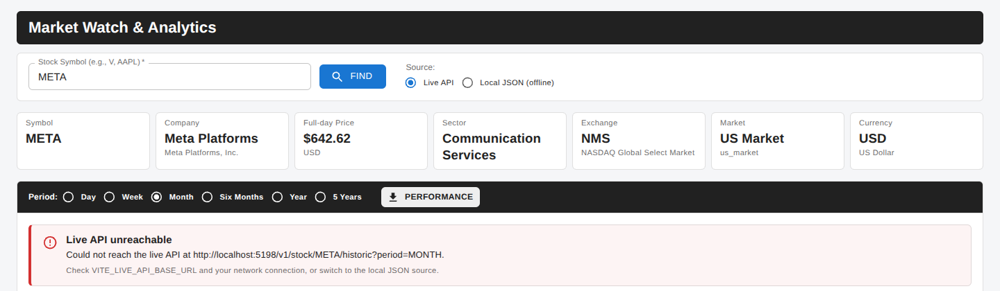</td>
</tr>
</table>

### 3.7 High/low tiles, chart and table from the historic API

The original composition returns, with three differences in the *data* behind it:

| Element | Before (derived from 24 CSV rows) | After |
| --- | --- | --- |
| Price tile | last row of the series | **Latest Price** = last sample of `/historic`, change chip = first → last sample of the chosen period |
| High / Low | `max`/`min` of the 24 samples, one tile | **High** and **Low** tiles from `/highlow`, each with the timestamp it occurred (`Oct 21, 11:30 AM` or `Jan 3, 2023`) |
| Chart / table | always 24 hourly points | the period's samples: 14 hourly (Day), 5 daily (Week), 20 daily (Month), 13 fortnightly (Six Months), 26 fortnightly (Year), 61 monthly (5 Years) |

<table>
<tr><th width="50%">Day — hourly samples, market hours with offset</th><th width="50%">5 Years — 61 monthly samples</th></tr>
<tr>
<td>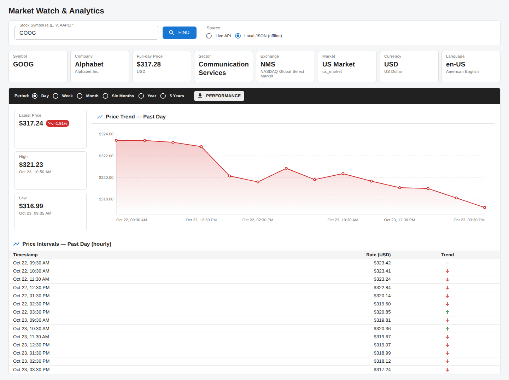</td>
<td>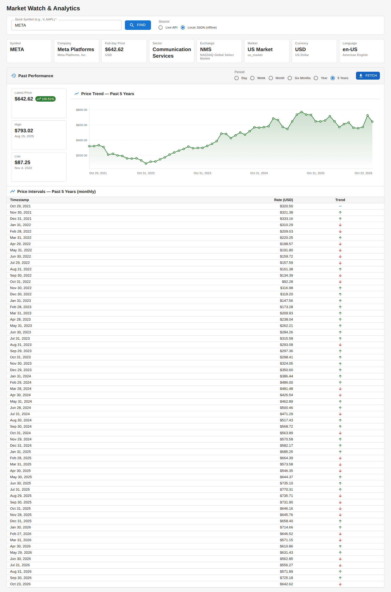</td>
</tr>
</table>

The same flow against the live API (served by a stub that replays the captures):

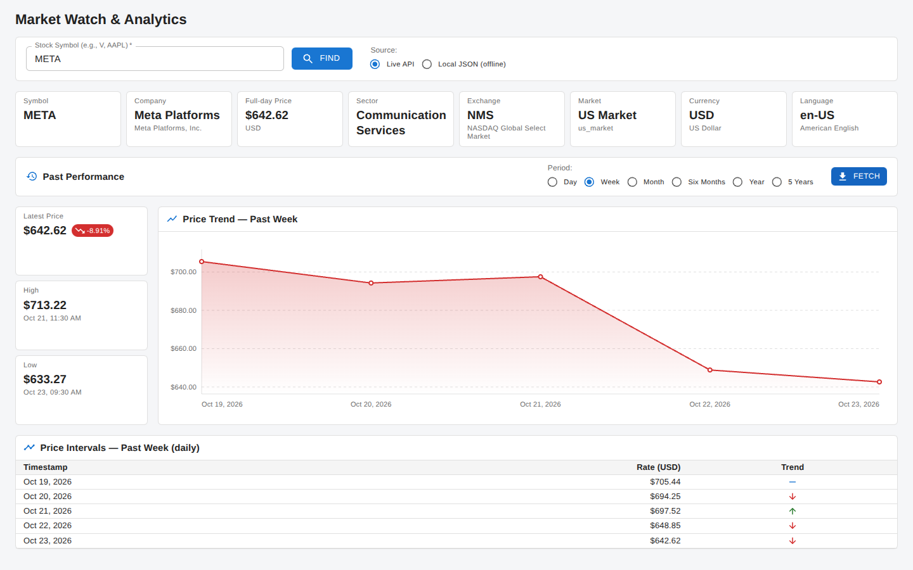

### 3.8 Visual polish (final rounds)

| Request | Result |
| --- | --- |
| Combine "Past Performance", "Price Trend" and "Price Intervals" into one group | Single outlined panel; chart and table rendered `embedded` (no borders of their own) and separated by dividers |
| Hide chart/table until the first fetch, and again whenever the period changes | The panel is just its toolbar until **Performance** is clicked; changing a radio clears the results (and any error) |
| Tighten the toolbar; bigger title; then remove the title; dark background with white bold text | Dark `grey.900` toolbar, white bold `Period:` and radio labels, white **Performance** button; no visible title (region still named for assistive tech) |
| Rename "Fetch" → "Performance"; remove the Language tile | Done; the 7 remaining tiles stretch to fill the row |
| Style "Market Watch & Analytics" like the toolbar | Both bars share one `DARK_TOOLBAR_SX` constant; a test asserts their computed styles are equal |

<table>
<tr><th width="50%">Before — initial state</th><th width="50%">After — initial state</th></tr>
<tr>
<td>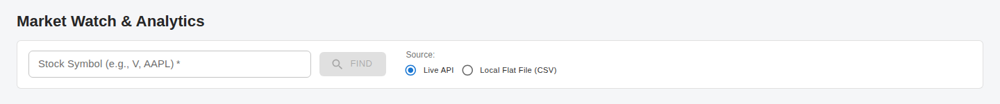</td>
<td>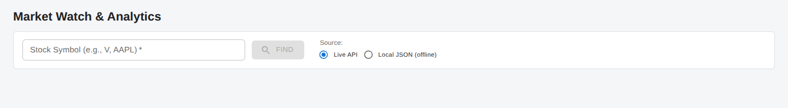</td>
</tr>
<tr><th>Before — loading</th><th>After — loading</th></tr>
<tr>
<td>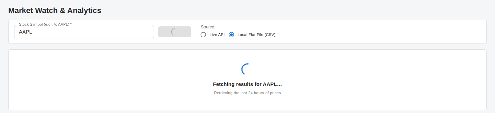</td>
<td>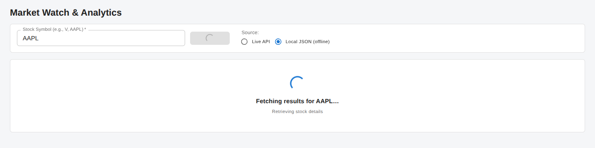</td>
</tr>
</table>

Responsive behaviour is preserved — tiles wrap, the summary column stacks above the chart:

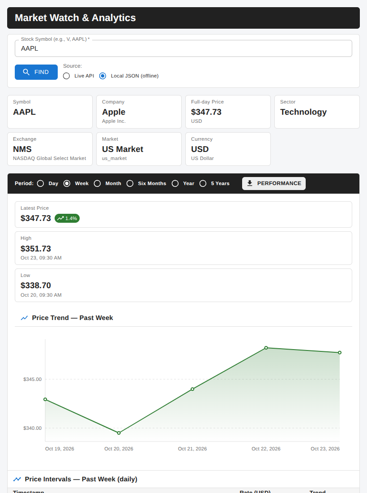

---

## 4. API contract — before vs after

| | Before | After |
| --- | --- | --- |
| Details | — | `GET /stock/{SYMBOL}` |
| Prices | `GET /prices/{SYMBOL}?interval=1h&limit=24` (assumed) | `GET /stock/{SYMBOL}/historic?period={PERIOD}` |
| High / low | — (computed client-side) | `GET /stock/{SYMBOL}/highlow?period={PERIOD}` |
| Auth | `Authorization: Bearer` when configured | unchanged |
| Config | `VITE_LIVE_API_BASE_URL`, `_KEY`, `_TIMEOUT_MS` | unchanged |

Observed facts about the real payloads that the code now accounts for:

- `/historic` `datetime` is a full timestamp with offset for `DAY` (`2026-10-22T09:30:00-04:00`) and a
  **bare date** (`2026-10-19`) for every other period. Bare dates are formatted as calendar dates in UTC,
  because `new Date('2026-10-19')` rendered in a US time zone would show the previous day.
- `/highlow` spells the fields `highOccured` / `lowOccured`.
- `/historic` carries `count` and `cached`, which are informational and ignored.
- The parsers check the response's `ticker`/`period` against the request; a mismatched response
  is reported as malformed instead of being displayed under the wrong label.

---

## 5. Data model — before vs after

```ts
// Before: everything hung off one series
interface StockData {
  symbol: string;
  currentPrice: number; highPrice: number; lowPrice: number; changePercent: number;
  history: HourlyPrice[];            // { hour, price, trend }
}

// After: reference data and performance are separate, explicitly typed views
interface StockData      { symbol: string; details: StockDetails }
interface StockDetails   { symbol; displayName?; longName?; sector?; exchange?; market?; currency?; language?; fulldayPrice? }
interface PriceSeries    { symbol; period: PerformancePeriod; interval: string; records: PriceRecord[] }
interface HighLow        { symbol; period; high: PriceExtreme; low: PriceExtreme }   // { price, occurredAt }
interface PastPerformance{ symbol; period; interval; latestPrice; changePercent; points: TrendPoint[]; high; low }
type PerformancePeriod = 'DAY' | 'WEEK' | 'MONTH' | 'HALF_YEAR' | 'YEAR' | 'FIVE_YEAR';
```

`HourlyPrice { hour }` became `TrendPoint { label }` because the x-axis is no longer necessarily hourly.

---

## 6. Architecture — before vs after

```
Before                                         After
──────                                         ─────
PriceProvider.getPrices(symbol)                StockProvider.getDetails(symbol)
  ├─ CsvPriceProvider  (public/local-data.csv)               .getPriceSeries(symbol, period)
  └─ LiveApiPriceProvider (/prices, placeholder)             .getHighLow(symbol, period)
                                                 ├─ LocalStockProvider  (public/data/*.json)
stockAnalytics.summarizeStock(records)           └─ LiveApiStockProvider (/stock, /historic, /highlow)
  → StockData
                                               data/payload.ts            shared validators + InvalidPayloadError
stockService.lookup(symbol, source)            data/stockDetails.ts       ─┐
  → StockData                                  data/priceSeries.ts         ├ one parser per payload, used by BOTH providers
                                               data/highLow.ts            ─┘
useStockLookup
                                               stockService.lookup(symbol, source)            → StockData
App                                            stockService.performance(symbol, period, src)  → PastPerformance
  LookupForm
  StockSummaryCards | PriceChart               useStockLookup (+ remembers the source)
  HourlyPriceTable                             usePerformanceLookup (fetch / reset; last-request-wins)

                                               App
                                                 dark header
                                                 LookupForm
                                                 StockDetailCards (Tile grid)
                                                 PastPerformanceSection
                                                   dark toolbar: PeriodSelector + Performance
                                                   StockSummaryCards | PriceChart (embedded)
                                                   HourlyPriceTable (embedded)
```

### Files

| | Files |
| --- | --- |
| **Removed** | `src/data/csv/parseCsv.ts`, `src/data/csv/parsePriceRecords.ts`, `src/data/providers/CsvPriceProvider.ts`, `src/data/providers/PriceProvider.ts`, `src/data/providers/LiveApiPriceProvider.ts`, `public/local-data.csv` (+ their tests) |
| **Added** | `types/performance.ts`, `data/payload.ts`, `data/stockDetails.ts`, `data/priceSeries.ts`, `data/highLow.ts`, `data/providers/StockProvider.ts`, `data/providers/LiveApiStockProvider.ts`, `data/providers/LocalStockProvider.ts`, `hooks/usePerformanceLookup.ts`, `utils/format.ts`, `utils/symbol.ts`, `components/Tile.tsx`, `components/StockDetailCards.tsx`, `components/PastPerformanceSection.tsx`, `components/PeriodSelector.tsx`, `components/embedded.ts`, `components/darkToolbar.ts`, `public/data/*.json` (39) |
| **Modified** | `App.tsx`, `types/stock.ts`, `services/stockAnalytics.ts`, `services/stockService.ts`, `hooks/useStockLookup.ts`, `components/{PriceChart,HourlyPriceTable,StockSummaryCards,LookupForm,LoadingIndicator}.tsx`, `charts/priceChartLayout.ts`, `errors/lookupError.ts`, `config/liveApiConfig.ts`, `vite.config.ts`, `README.md`, `.env.example` |
| **Unchanged** | `charts/scales.ts`, `charts/paths.ts`, `components/{ErrorBanner,TrendIndicator}.tsx`, `hooks/useElementWidth.ts`, `utils/timing.ts`, `theme.ts`, `layout.ts`, `main.tsx` |

Design principles carried over from the original code base and applied to the new code: every
layer is a plain function or interface with dependencies injected (providers into the service, the
service into `App`, HTTP client into the live provider, JSON loader into the offline provider);
parsing is isolated in single pure functions; UI components are functions of their props.

---

## 7. Quality and verification

| | Before | After |
| --- | --- | --- |
| Test files / tests | 28 / 172 | 36 / 275 |
| Contract tests | `/prices` parser | one suite per parser (`stockDetails`, `priceSeries`, `highLow`, `payload`) driven by the captured JSON |
| Provider tests | CSV, live (`/prices`) | live (3 endpoints, URL building, request/response mismatch, error mapping), offline (paths, 404 and SPA-fallback handling, malformed files) |
| Fixture guards | CSV has 5 symbols × 24 rows | every symbol × period × endpoint file exists and parses |
| App integration | CSV flows | live and offline flows, the two-call fetch, period-change reset, source pinning, loading/error containment, real default wiring against the configured host |
| Style guards | — | dark toolbar colours/weight; header ≡ toolbar |

Every round was also exercised end-to-end in headless Chromium against the Vite dev server, with the
live path served by a small stub replaying the captured responses (so "Live API" was verified over
real HTTP, not only with mocks).

Tooling gate at hand-over: `tsc -b`, `eslint .`, `vitest run`, `vite build` — all clean.
`package.json` / `package-lock.json` are unchanged throughout.

---

## 8. Behavioural details worth knowing

- **Source pinning.** Performance fetches use the source the symbol was loaded from, not the radio's
  current value.
- **Last request wins.** Both hooks ignore results of superseded requests, so rapid clicks cannot
  show stale data.
- **Minimum visible loading.** Both the lookup and the fetch show their indicator for ≥ 1 s
  (`withMinimumDuration`), so the instant offline source still gives feedback.
- **Offline "no file" detection** treats a 404 *or* a non-JSON 200 (an SPA host's `index.html`
  fallback) as "absent", so a missing fixture shows "not found" on any static host.
- **Currency.** All prices (tiles, chart axis, table) format in the stock's `currency` via `Intl`;
  unknown-but-well-formed codes render as `XYZ 1.00`, malformed codes fall back to `1.00 XYZ`.
- **Exchange names** are a small hand-maintained map of the codes the API is known to return
  (`NMS`, `NGM`, `NCM`, `NYQ`, `ASE`, `PCX`); unknown codes show the code alone.

## 9. Known limitations / suggested follow-ups

- The chart and table components keep their original file names (`PriceChart.tsx`,
  `HourlyPriceTable.tsx`) to avoid renames during hand-over; the latter now shows any interval.
- Period change discards loaded results even when switching back to the fetched period (strict reading
  of the requirement); caching per period would be a small addition in `usePerformanceLookup`.
- `json/` is left exactly as captured, including the two mis-named files; `public/data/` is the
  curated copy. Adding a symbol offline means adding its 13 files and listing it in `OFFLINE_SYMBOLS`.
- No unit tests run in a real browser; visual checks were manual (screenshots in this folder).

---

## 10. Screenshot index

| File | Shows |
| --- | --- |
| `before/00-initial.png`, `before/01-loading.png` | original empty and loading states |
| `before/AAPL.png`, `before/AAPL-overview.png`, `before/META.png` | original results from the CSV |
| `before/90-not-found.png`, `before/91-live-api-unreachable.png` | original error states |
| `screenshots/00-initial.png`, `01-loading.png` | new empty and loading states |
| `screenshots/AAPL.png`, `GOOG.png`, `META.png` | detail tiles + performance toolbar before fetching |
| `screenshots/02-performance-loading.png` | fetch in progress |
| `screenshots/AAPL-WEEK.png`, `GOOG-DAY.png`, `META-FIVE_YEAR.png` | performance loaded (offline) for three periods |
| `screenshots/live-META.png` | performance loaded via the live API (stub) |
| `screenshots/tablet-AAPL-WEEK.png` | 820 px layout |
| `screenshots/90-not-found.png`, `91-live-api-unreachable.png`, `92-performance-error.png` | error states |
